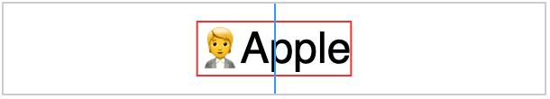
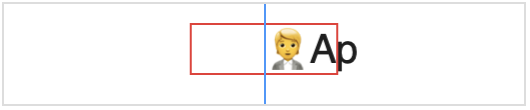

# Canvas `textAlign` is ignored for text containing a ZWJ emoji (Safari 26.5)

In Safari 26.5.2 (macOS), `CanvasRenderingContext2D.fillText` ignores
`textAlign = "center"` and `"right"` when the string contains an emoji ZWJ
sequence such as 🧑‍💼 (U+1F9D1 U+200D U+1F4BC). The text is drawn as if
`textAlign` were `"left"`: it starts at the `x` passed to `fillText`.

`measureText` still returns the correct width, and the same string without a
ZWJ (💼Apple) is aligned correctly.

**Live repro:** https://mattiawasfound.github.io/webkit-canvas-zwj-textalign/
(or open [`index.html`](index.html) locally; it has no dependencies).

## Steps

```js
const ctx = canvas.getContext("2d");
ctx.font = "24px sans-serif";
ctx.textAlign = "center";
ctx.fillText("\u{1F9D1}‍\u{1F4BC}Apple", 150, 33);   // "🧑‍💼Apple"
```

## Expected

The string is centred on `x = 150`, like every other string (Chrome, Firefox,
and the control rows on the repro page):



## Actual (Safari 26.5.2)

The string's left edge is at `x = 150`. The red box is where `measureText`
says the centred text should be:



## Notes

- Same result with `textAlign = "right"`, with the canvas attached to or
  detached from the document, with or without a `dir` attribute, with
  `ctx.direction = "ltr"`, and with web fonts or the system sans-serif.
- Not reproducible in Playwright's WebKit build (which reports itself as
  Safari 26.5), so it may depend on the system's text stack.
- Workaround: set `textAlign = "left"` and draw at
  `x - ctx.measureText(text).width / 2` (row 4 on the repro page).
- Where it bites: canvas whiteboards (for example Excalidraw) draw
  centred labels this way, so a label like "🧑‍💼Apple" starts at the centre
  of its box and is clipped on the right.
